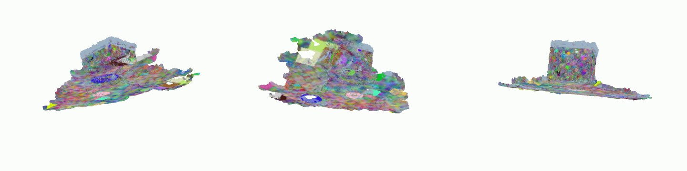

# 3D Reconstruction from 2D Images

A small, readable Python pipeline that turns a set of ordinary photos of an object (a plant, a figurine, anything)
into a coloured 3D model. Built step by step from the seminar *"3D reconstruction from 2D images"*
(Dr. Suxing Liu, DIVAS Alliance) so that every stage of the pipeline is its own file you can read, run and modify.


*Reconstruction of the built-in synthetic test scene (a textured cube on a floor, photographed from 36 positions) -
recovered purely from the photos.*

## The pipeline

| # | Stage (seminar slide) | File | What it does |
|---|---|---|---|
| 1 | Image collection | `images.py` | loads photos, checks them against the capture rules (count, blur, sizes) |
| 2 | Feature extraction | `features.py` | RootSIFT keypoints + descriptors |
| 3 | Feature matching | `matching.py` | ratio-test + mutual check, then RANSAC epipolar verification |
| 4 | Structure from Motion | `sfm.py` | camera poses + sparse 3D points, bundle adjustment |
| 5 | Dense point cloud | `dense.py` | rectified stereo (SGBM) between neighbouring cameras |
| 6 | Mesh reconstruction | `mesh.py` | Poisson surface reconstruction |
| 7 | Mesh refinement | `mesh.py` | drop floaters, decimate, Taubin smoothing |
| 8 | Mesh texturing | `texture.py` | per-vertex colour from the best-facing photos |
| - | Deliverable video | `render.py` | turntable `.mp4` of the model (what the assignment asks you to submit) |

See [`docs/pipeline.md`](docs/pipeline.md) for the geometry behind each stage.

## Setup (VS Code)

```bash
git clone https://github.com/<your-username>/<this-repo>.git
cd <this-repo>
python -m venv .venv
source .venv/bin/activate          # Windows: .venv\Scripts\activate
pip install -r requirements.txt
pip install -e .                   # lets you run `python -m recon3d` from anywhere
```

**Ubuntu / WSL (Windows Subsystem for Linux):** run `bash scripts/setup_ubuntu.sh` instead of the commands above. It also installs
the system libraries a fresh Ubuntu is missing - without them `import open3d` fails with
`ImportError: libusb-1.0.so.0: cannot open shared object file`. The manual equivalent is:

```bash
sudo apt install -y python3-venv python3-pip libusb-1.0-0 libgl1 libgomp1 libglib2.0-0 libx11-6
pip uninstall -y opencv-python && pip install opencv-python-headless   # no display on WSL/servers
```
Keep the project in your Ubuntu home folder (`~`), not under `/mnt/c`, for speed.

In VS Code: *Ctrl/Cmd+Shift+P -> Python: Select Interpreter -> `.venv`*. The `.vscode/` folder already has
debug configurations (Run and Debug panel) for each command below. Python 3.9-3.13 works.

## Use it

```bash
# 0. sanity check the whole install on fake photos with known answers (~2 min)
python -m recon3d synthetic data/synthetic
python -m recon3d run data/synthetic --out output/synthetic_run --window 6

# 1. put 20+ of YOUR photos in data/images/, then check them
python -m recon3d check data/images

# 2. look at what features/matching do (recreates the seminar's keypoint + match slides)
python -m recon3d features-demo data/images/IMG_001.jpg data/images/IMG_002.jpg

# 3. reconstruct
python -m recon3d run data/images --out output/run1
```

### Notebook version (VS Code)

`notebooks/01_reconstruction_walkthrough.ipynb` runs the same pipeline **one stage per cell** with pictures after every step
(keypoints, raw vs verified matches, camera positions, sparse and dense clouds, final model) and a short explanation of the
idea behind each. Open it in VS Code (install the *Jupyter* extension), pick the `.venv` kernel, and *Run All*.
It uses the synthetic test photos by default; set `IMAGE_DIR` in its first code cell to use your own. About 3-4 minutes.

Results land in `output/run1/`: `sparse.ply`, `dense.ply`, `model.ply` / `model.obj` (open in MeshLab or Blender),
`model_turntable.mp4`, and `debug/` pictures of keypoints and matches.

Useful options: `--window N` (photos taken in order around the object: only match neighbours, much faster),
`--max-dim 1200` (smaller = faster), `--depth 9` (finer mesh), `--skip-dense` (mesh straight from SfM points).

Run the tests with `pytest -q` - they build a synthetic scene with known camera positions and check that SfM recovers
them (currently mean error < 1% of the orbit radius, sub-pixel reprojection error).

## Taking good photos (the checklist from the assignment)

At least 20 sharp photos (more is better) - subject centred, walk in a circle at high/middle/low heights,
70-80 % overlap between neighbours, every camera pointing at the subject, same distance, no hard shadows or
reflections, no blur. Details and a printable checklist: [`docs/capture_guide.md`](docs/capture_guide.md).

## Baseline for comparison

The assignment also asks you to build a model with Polycam. Keep that result as your reference and compare it
with this pipeline's output: [`docs/polycam_workflow.md`](docs/polycam_workflow.md).

## Honest limitations

* Verified end-to-end on the synthetic scene (all 36 cameras recovered, 0.22 px reprojection error). Real photos are
  messier - expect to tune `--max-dim`, `--features` and `--depth`, and keep notes in `docs/experiments.md`.
* Focal length comes from EXIF when available, else a guess (1.2 x longest side). A wrong guess hurts accuracy; for
  precise work calibrate the camera.
* Dense reconstruction uses simple two-view stereo. Thin structures (leaves, stems) and untextured or shiny surfaces
  are hard for any photogrammetry method. For production quality run [COLMAP](https://colmap.github.io/) on the same
  photos and compare.
* Texturing is per-vertex colour, not a UV texture atlas.
* The turntable video is encoded as H.264 (via the `imageio-ffmpeg` package) so it plays in VS Code and can be uploaded as is.
* The model's scale is arbitrary (SfM can't know the real size). Put a ruler in the scene if you need real units.

## Repo layout

```
src/recon3d/      the pipeline (one module per stage)
scripts/          setup_ubuntu.sh (Ubuntu/WSL one-shot setup)
notebooks/        step-by-step walkthrough notebook
tests/            pytest end-to-end test on synthetic data
docs/             capture guide, pipeline notes, Polycam workflow, roadmap, experiment log
data/images/      your photos (git-ignored)
output/           results (git-ignored)
```

Course materials from the professor (slides, assignment, sample dataset) are intentionally **not** in this repo.
